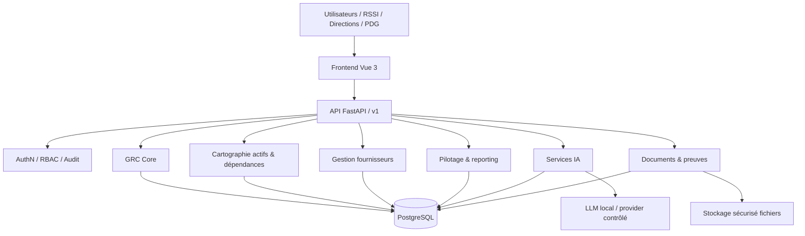

# PGCC — Architecture cible de référence

**Statut :** Architecture cible proposée et référence de développement  
**Version :** 1.0  
**Date :** 21 novembre 2026  
**Branche de référence :** `chore/phase0-stabilization`

## 1. Objectif

PGCC évolue vers une plateforme intégrée de Gouvernance, Risques et Conformité (GRC), destinée à centraliser le pilotage de la sécurité de l'information, la gestion des risques, la conformité, les audits, les actifs, les fournisseurs et les plans d'action.

Cette architecture est une cible évolutive. Les modules déjà opérationnels doivent être conservés et renforcés : toute évolution doit être incrémentale, testée et compatible avec les données existantes.

## 2. Principes directeurs

- **Modular monolith first :** backend et frontend organisés par domaines fonctionnels ; pas de microservices à ce stade.
- **Source de vérité unique :** une donnée métier est créée et maintenue dans un module propriétaire puis référencée par les autres modules.
- **Traçabilité :** opérations métier importantes, changements, validations et exports sont auditables.
- **Security by design :** RBAC, validation serveur, moindre privilège, contrôle des accès aux documents, sécurité des API et gestion des secrets.
- **Évolutivité maîtrisée :** migrations versionnées, contrats API explicites, tests de non-régression et compatibilité.
- **Déploiement contrôlé :** priorité à l'hébergement maîtrisé, à la confidentialité et à la possibilité d'utiliser des services IA locaux.
- **Data-driven reporting :** indicateurs et rapports calculés à partir des données persistées ; l'IA ne doit pas inventer les chiffres.
- **Interopérabilité :** exports documentés et API versionnées lorsque cela est utile.

## 3. Architecture logique

## 4. Socle technologique existant

Le projet utilise actuellement :
- Frontend : Vue 3, Vue Router et services API dédiés.
- Backend : FastAPI, SQLAlchemy et Pydantic.
- Base de données : PostgreSQL ; capacités vectorielles utilisées par le socle documentaire selon la configuration.
- Migrations : Alembic.
- Conteneurisation : Docker Compose.
- IA : service abstrait permettant une intégration locale ou contrôlée.
- Authentification, RBAC, journalisation de sécurité et API versionnée.

Les évolutions doivent s'intégrer à ces technologies, sauf décision d'architecture documentée.

## 5. Modules fonctionnels cible

### 5.1 Gouvernance
- Politique SSI, objectifs, rôles et responsabilités.
- Organisation, directions et périmètres.
- Référentiels et décisions.
- Suivi des revues de gouvernance.

### 5.2 Gestion des risques
- Identification, analyse, évaluation et traitement.
- Risques inhérents et résiduels.
- Propriétaires, échéances, mesures et historique.
- Liens avec actifs, processus, fournisseurs, contrôles, audits et actions.

### 5.3 Cartographie des actifs et dépendances
- Inventaire des actifs informationnels, matériels, logiciels, services, applications, infrastructures et processus.
- Propriétaire, gestionnaire, localisation, criticité, classification, état du cycle de vie et source de l'inventaire.
- Relations de dépendance entre actifs.
- Associations aux risques, contrôles, incidents, fournisseurs et actions.
- Vue de cartographie et analyse d'impact.

### 5.4 Conformité
- Référentiels (ex. ISO 27001), exigences et contrôles.
- Évaluations, maturité, statut, preuves et écarts.
- Actions correctives associées.
- Traçabilité de l'évaluation et de sa validation.

### 5.5 Audits
- Programme, périmètre, mission et auditeurs.
- Constats, recommandations, preuves et niveaux de gravité.
- Actions de remédiation et vérification de clôture.
- Historique et rapports d'audit.

### 5.6 Actions
- Plan d'action centralisé.
- Origine : risque, contrôle, audit, incident, fournisseur ou autre.
- Responsable, échéance, priorité, statut, preuve, vérification d'efficacité.
- Workflow et journal d'historique.

### 5.7 Fournisseurs et tiers
- Référentiel fournisseurs.
- Services fournis et contrats.
- Clauses de sécurité, dates, renouvellement et alertes.
- Évaluation initiale et périodique.
- Accès accordés, périmètre, approbation, expiration et revue.
- Risques tiers et actions de traitement.

### 5.8 Documents et preuves
- Documents versionnés et métadonnées.
- Classification, propriétaire, confidentialité et dates de validité.
- Association aux contrôles, risques, audits, actions, fournisseurs et actifs.
- Contrôle d'accès, validation, journalisation, conservation et archivage.
- Protection contre les fichiers malveillants et limites d'upload.

### 5.9 Pilotage et reporting
- Dashboard opérationnel RSSI.
- Dashboard exécutif PDG/direction.
- KPI calculés depuis les données métier.
- Rapports périodiques, rapports d'audit et rapports thématiques.
- Export PDF, CSV ou XLSX selon les besoins.
- Filtrage par période, direction, périmètre et criticité.

### 5.10 Assistant IA
- Recherche documentaire et assistance contextuelle.
- Synthèse des risques, contrôles, constats et actions.
- Aide à la rédaction des rapports et plans de traitement.
- Suggestions explicables et sourcées.
- Aucune décision de risque, validation ou clôture automatique sans workflow d'approbation.

## 6. Architecture applicative

### Backend
Organiser les composants par domaine (models, schemas, services, endpoints, tests) en conservant le socle FastAPI. Les modules ne doivent pas importer directement les détails internes d'un autre domaine lorsque l'accès peut passer par un service ou un contrat métier.

### Frontend
Les vues doivent être organisées par module. Les services API, composants partagés, navigation, permissions et gestion des erreurs doivent rester centralisés. Les modules sont intégrés au layout et au routeur existants.

### Base de données
PostgreSQL est la source de vérité transactionnelle. Les relations métier utilisent des clés étrangères lorsque possible. Les relations polymorphes doivent être explicitement documentées et validées. Les migrations Alembic doivent être séquentielles, testées et réversibles lorsque raisonnablement possible.

### Documents
Les métadonnées sont stockées en base ; les fichiers dans un stockage sécurisé configuré. Les permissions des métadonnées et des fichiers doivent être cohérentes. Ne jamais exposer de chemins internes ou de liens de stockage non autorisés.

## 7. Sécurité transversale

- RBAC avec permissions par module et par action ; périmètre organisationnel si requis.
- Vérification serveur de toute permission ; le frontend ne constitue pas une barrière de sécurité.
- Authentification et gestion des sessions sécurisées.
- Journalisation des opérations sensibles, accès, changements, validations et exports.
- Validation des entrées, pagination et limites de requêtes.
- Protection contre injections, XSS, CSRF selon le mécanisme d'authentification, SSRF et abus des uploads.
- Secrets hors dépôt ; configuration via variables et gestionnaire de secrets.
- Tests de sécurité et de non-régression dans CI.
- Sauvegarde, restauration et stratégie de rétention documentées.

## 8. Principes d'intégration

- Chaque module possède ses données maîtres et expose des références.
- Éviter les duplications de données : utiliser les IDs et relations.
- Les KPI sont calculés par des services dédiés, avec définitions versionnées.
- Les opérations multi-entités doivent être transactionnelles lorsque nécessaire.
- Les changements de modèle passent par migrations.
- Les événements métier (création de risque, constat, action, revue fournisseur, changement de criticité) peuvent alimenter notifications et audit.

## 9. Roadmap de référence

### Phase 0 — Stabilisation
- CI, tests, migrations, sécurité, dette technique et compatibilité des modules existants.
- Documentation d'architecture et modèle de données.

### Phase 1 — Cartographie des actifs et dépendances
- Modèle Asset et AssetRelationship.
- CRUD/API, RBAC, audit, tests et interface.
- Liens progressifs avec applications, risques, contrôles, documents et fournisseurs.
- Vue de dépendances et analyse d'impact.

### Phase 2 — Fournisseurs et tiers
- Référentiel, contrats, évaluations, accès et alertes.
- Liens avec actifs, risques, actions et preuves.

### Phase 3 — Pilotage
- Définitions KPI.
- Dashboard RSSI et exécutif.
- Rapports générés à partir de données vérifiables.

### Phase 4 — Automatisation et IA
- Notifications, revues périodiques, workflows.
- Assistant IA contextualisé, explicable et soumis aux permissions.

## 10. Gouvernance des changements

Toute évolution doit :
1. Identifier les modules et contrats affectés.
2. Proposer une migration si le modèle change.
3. Ajouter ou adapter les tests.
4. Vérifier les permissions et journaux.
5. Vérifier l'impact frontend/API.
6. Documenter les décisions architecturales significatives.
7. Éviter les modifications destructives et les changements non rétrocompatibles sans plan.

## 11. Critères de conformité à l'architecture

Une fonctionnalité est considérée conforme si :
- elle respecte le domaine propriétaire des données ;
- elle ne duplique pas inutilement les objets existants ;
- elle applique les permissions serveur ;
- elle journalise les opérations sensibles ;
- elle dispose de tests adaptés ;
- elle utilise une migration versionnée lorsque nécessaire ;
- elle ne dégrade pas les fonctionnalités existantes ;
- sa documentation et ses contrats sont mis à jour.
