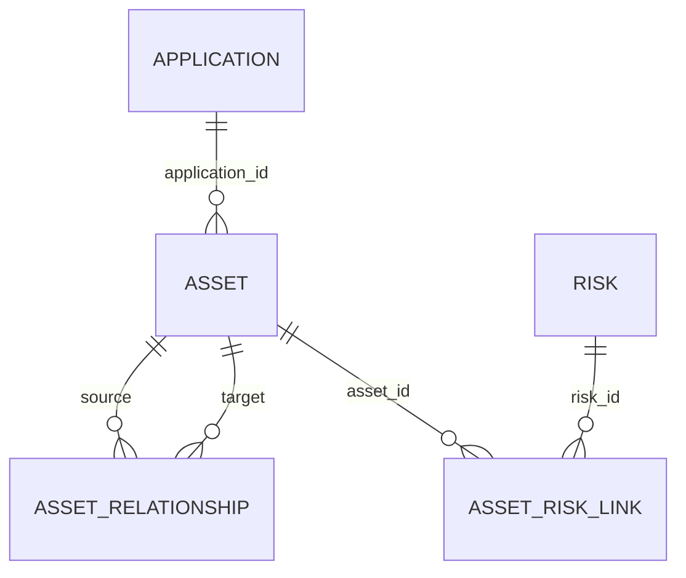

# Revue du modèle de données — Cartographie des actifs

**Périmètre :** modèle Asset, relations de dépendance, liens vers les risques et applications.  
**Référence :** branche `chore/phase0-stabilization`, migrations `0006` à `0009`.

## 1. Modèle logique validé

- `Asset` est le référentiel central d'inventaire.
- `AssetRelationship` représente les relations orientées entre actifs.
- `AssetRiskLink` matérialise la relation N:N entre actifs et risques.
- `Application` reste le catalogue applicatif existant; plusieurs actifs peuvent référencer une application.

## 2. Règles d'intégrité

| Domaine | Règle |
|---|---|
| Identité | UUID technique et référence métier obligatoire |
| Référence | Unicité SQL actuelle sur la valeur exacte |
| Application | FK avec suppression restrictive; cardinalité N actifs vers 1 application |
| Relations | Source et cible obligatoires, différentes, FK restrictives |
| Relations dupliquées | Unicité sur source, cible et type |
| Dépendances | Le backend bloque les nouveaux cycles `depends_on` |
| Risques | Unicité d'une paire actif/risque |
| Retrait | Retrait logique via `retired_at`, pas de suppression physique d'actif dans l'API |
| CIA | Valeurs contrôlées par contraintes SQL et validation Pydantic |
| Cycle de vie | Valeurs contrôlées par contrainte SQL et validation Pydantic |

## 3. Indexation

La migration `0009_asset_inventory_filter_indexes` ajoute des index sur les colonnes utilisées par les filtres d'inventaire : propriétaire, localisation, cycle de vie, criticité et classification. Les index existants sur référence, nom, application, direction, hostname et numéro de série sont conservés.

## 4. Politique de liaison inter-modules

- Lecture de la cartographie : `assets:read`.
- Création/modification/retrait : permissions dédiées `assets:create/update/delete`.
- Export de données techniques : `assets:export`, réservé aux rôles Admin et Auditor.
- Lecture des risques depuis la cartographie : `risks:read` en plus de `assets:read`.
- Modification d'une liaison actif/risque : `assets:update` ET `risks:update`.
- Les champs de risque ne sont inclus dans l'analyse d'impact que si `risks:read` est accordée.

## 5. Points à traiter avant l'intégration Fournisseurs

1. **Normalisation de référence :** la contrainte SQL actuelle est sensible à la casse alors que l'import CSV détecte les références sans tenir compte de la casse. Une normalisation uniforme et un index unique fonctionnel nécessitent d'abord un audit des doublons historiques.
2. **Hostname et numéro de série :** la détection de doublons CSV est une validation applicative. Il n'existe pas encore de contraintes uniques SQL sur ces champs; il faut confirmer les règles d'unicité réelles avec les équipes d'exploitation avant de les imposer.
3. **Responsable et direction :** `owner`, `custodian` et `direction` sont encore des chaînes libres. Le futur référentiel Organisation/Utilisateurs devra être relié par clés étrangères dans une migration progressive, avec correspondance et reprise contrôlées.
4. **Historique métier :** le journal de sécurité trace les opérations, mais le modèle n'est pas encore un historique versionné complet des changements de chaque actif.
5. **Suppression des risques :** la FK `AssetRiskLink.risk_id` utilise désormais `ON DELETE RESTRICT`. Avant de généraliser l'archivage, confirmer si la suppression d'un risque doit être bloquée dès qu'il est lié à des actifs afin de préserver la traçabilité métier.
6. **Relations orientées :** les types de relation sont stockés en texte contrôlé; la sémantique source/cible doit être documentée et normalisée avant l'ajout de relations fournisseurs.

## 6. Décision d'architecture

Le modèle actuel est suffisamment stable pour achever la tranche Cartographie, sous réserve de conserver les points de vigilance ci-dessus comme prérequis de conception du module Fournisseurs. Le module Fournisseurs devra référencer les actifs et contrats par relations explicites, et ne pas introduire de champs fournisseurs libres dans `Asset`.

## 7. Chaîne de migrations

`0006_asset_inventory` → `0007_asset_risk_links` → `0008_asset_application_cardinality` → `0009_asset_inventory_filter_indexes`.

Les migrations doivent être vérifiées sur une base de test vide et sur une copie représentative de la base existante avant tout déploiement. Le downgrade `0008` peut échouer si une application possède plusieurs actifs; ne pas l'exécuter sans contrôle des données.

## 8. Protection de la traçabilité Actif–Risque

La suppression physique d'un risque est refusée tant qu'il possède des associations avec des actifs. La FK `asset_risk_links.risk_id` est configurée en `ON DELETE RESTRICT` (migration `0010_asset_risk_restrict_delete`). La suppression d'une association doit passer par l'endpoint explicite de dissociation, autorisé uniquement avec `assets:update` et `risks:update`. Cela évite la disparition silencieuse du contexte de cartographie.

## 9. Unicité des références — migration 0011

Les références sont désormais débarrassées des espaces périphériques à l'entrée API et une unicité insensible à la casse est imposée en base par l'index unique fonctionnel `uq_assets_reference_ci`. La migration effectue un contrôle préalable des doublons historiques après `lower(btrim(reference))` et s'arrête avec les références concernées au lieu de modifier ou supprimer des données. En cas d'échec, corriger les doublons manuellement après arbitrage métier puis relancer la migration. Les références existantes ne sont pas automatiquement renommées.

## 10. Revalidation Phase 0 — 27 novembre 2026

Cette section supersède les points historiques dont le statut a évolué depuis la revue initiale.

- La référence métier Asset dispose désormais d'une unicité normalisée en base via `uq_assets_reference_ci` (migration 0011) ; l'ancienne mention d'une unicité sensible à la casse n'est plus actuelle.
- L'association Asset–Risk est en place, avec API de liaison/déliaison, permissions croisées `assets:update` et `risks:update`, audit et tests PostgreSQL. La FK `asset_risk_links.risk_id` est restrictive (migration 0010).
- La suppression d'un risque est bloquée en présence d'actions correctives, de liens d'actifs ou de liens fournisseurs ; les actions historiques sont protégées par `ON DELETE RESTRICT` (migration 0031).
- Les liens de dépendance Asset–Asset ont une unicité source/cible/type et des FK restrictives. Le test PostgreSQL `test_concurrent_opposing_dependency_edges_allow_only_one_direction` valide la sérialisation des créations de directions opposées.
- Le test PostgreSQL `test_concurrent_asset_risk_link_and_risk_delete_are_serialized` valide les issues concurrentes possibles entre liaison actif-risque et suppression du risque.
- Le workflow `45961991384` sur le commit de code `ed0e273` est vert 5/5 ; le job PostgreSQL rapporte 42 tests réussis, et les jobs Compose/Production runtime valident les scénarios runtime automatisés.
- Aucune preuve CI ne remplace la revue métier de la sémantique des relations, la recette sur données représentatives ni la validation de production.
