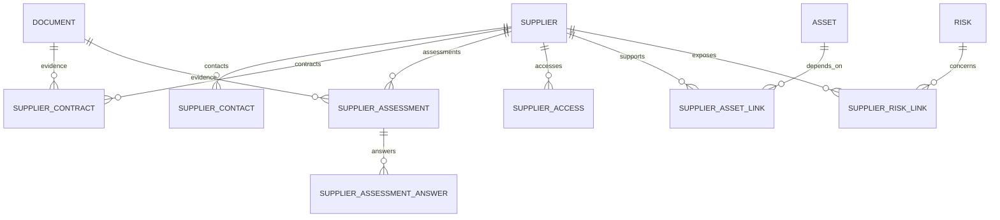

# Conception du module Fournisseurs (TPRM)

**Statut :** conception cible validée pour démarrer l'implémentation après validation des prérequis de migration Cartographie.  
**Architecture :** monolithe modulaire PGCC; PostgreSQL; API FastAPI; interface Vue 3.  
**Principe :** le fournisseur est un tiers métier partagé, relié aux actifs, contrats, accès, évaluations et risques sans dupliquer les référentiels existants.

## 1. Objectifs métier

Le module doit permettre au RSSI et aux directions métiers de :
- tenir un référentiel des fournisseurs et prestataires;
- identifier les services fournis et les actifs/activités dépendants;
- suivre les contrats, leurs échéances et clauses de sécurité;
- recenser les accès logiques et physiques accordés aux tiers, leurs approbations et revues;
- évaluer le niveau de sécurité des fournisseurs selon leur criticité;
- piloter les plans de remédiation, les risques et les revues périodiques;
- produire des preuves et rapports d'audit.

Le module ne doit pas devenir un simple carnet d'adresses ni un coffre de secrets.

## 2. Modèle de données cible

### 2.1 Supplier

Référentiel maître :
- UUID, code interne unique, raison sociale, nom commercial;
- identifiant légal (facultatif et soumis à règles de confidentialité), pays;
- catégorie de service, description du périmètre et services rendus;
- propriétaire métier interne (FK User), direction responsable;
- criticité métier, niveau de dépendance, statut de relation;
- catégories de données traitées, localisation/hébergement, sous-traitance ultérieure;
- dates de création et mise à jour, statut d'archivage.

Ne pas stocker les coordonnées bancaires ou données personnelles non nécessaires au suivi SSI.

### 2.2 SupplierContact

Contacts professionnels (nom, fonction, email/téléphone professionnels, type de contact, actif/inactif). Les contacts ne remplacent pas le propriétaire métier interne.

### 2.3 SupplierContract

Contrats, avenants et renouvellements :
- fournisseur, référence contractuelle, type, objet/périmètre;
- date de début, date de fin, préavis et renouvellement;
- propriétaire interne, statut contractuel;
- clauses SSI : confidentialité, notification d'incident, audit, continuité, réversibilité, localisation, sous-traitance, restitution/destruction;
- références vers les documents de preuve existants.

Les fichiers restent dans le module Documents; le module Fournisseurs référence les documents par FK, ne crée pas un second stockage.

### 2.4 SupplierAssessment et SupplierAssessmentAnswer

Évaluation datée et historisée :
- type (initiale, périodique, renouvellement, incident, changement majeur);
- périmètre, évaluateur, date, échéance de prochaine revue;
- questionnaire/version, réponses, preuves et commentaires;
- score calculé côté serveur, niveau de risque, décision et statut;
- plan d'amélioration lié aux Actions existantes lorsque nécessaire.

Le score doit être reproductible à partir des réponses et de la version du questionnaire. Pas de score opaque ni de décision automatique sans validation humaine.

### 2.5 SupplierAccess

Registre des accès accordés aux tiers :
- fournisseur, personne/compte externe, actif ou application concerné;
- type d'accès, privilège, environnement, justification;
- approbateur interne, dates de début et fin, statut;
- dernière revue, prochaine revue, date de révocation effective;
- référence ticket/changement et journal de validation.

**Interdiction de stocker** mots de passe, clés privées, jetons, secrets API ou codes MFA. Le registre décrit les droits; les secrets restent dans les coffres techniques approuvés.

### 2.6 SupplierAssetLink et SupplierRiskLink

Associations explicites N:N :
- fournisseur ↔ actifs concernés, avec contexte, criticité de dépendance et période de validité;
- fournisseur ↔ risques, avec contexte et date de création.

Ne pas utiliser le type de relation générique `supplied_by` comme unique source de vérité du tiers : une association typée et contrainte est nécessaire pour les recherches, revues et indicateurs.

### 2.7 Historisation

Les évaluations, changements d'accès, décisions contractuelles et liens fournisseurs doivent être traçables. Les éléments d'audit ne doivent pas être écrasés lors d'une mise à jour. Prévoir des journaux dédiés et le journal de sécurité transversal.

## 3. Relations avec les modules existants

| Module existant | Interaction Fournisseurs |
|---|---|
| Cartographie | Lien fournisseur ↔ actifs, dépendances, criticité et analyse d'impact |
| Risques | Lien fournisseur ↔ risques; lecture et création selon permissions croisées |
| Actions | Actions correctives issues des évaluations ou incidents |
| Documents | Contrats, attestations, rapports et preuves conservés dans le référentiel documentaire |
| Utilisateurs/RBAC | Propriétaire interne, évaluateurs, approbateurs et périmètres |
| Audit/Sécurité | Journalisation des consultations sensibles, changements, exports et révocations |
| Pilotage | KPI de criticité, échéances, accès non revus, évaluations et actions ouvertes |

## 4. Cycle de vie métier

### Fournisseur
`À qualifier → En évaluation → Approuvé / Approuvé sous conditions → Suspendu → Terminé / Archivé`

L'archivage n'efface pas les contrats, évaluations, accès historiques ou associations aux risques.

### Contrat
`Brouillon → En validation → Actif → À renouveler / Expiré → Résilié`

Alertes configurables avant fin et préavis; les alertes ne remplacent pas une décision du propriétaire contractuel.

### Accès tiers
`Demandé → À approuver → Actif → À revoir → Révoqué / Expiré`

Toute activation exige un approbateur interne et une période de validité. Une prolongation est une nouvelle décision tracée.

### Évaluation
`À planifier → En cours → À valider → Validée → Remédiation / Clôturée`

Les réévaluations créent une nouvelle version, ne remplacent jamais l'évaluation précédente.

## 5. Permissions proposées

Permissions distinctes, vérifiées côté API et interface :
- `suppliers:read`
- `suppliers:create`
- `suppliers:update`
- `suppliers:archive`
- `suppliers:manage_contracts`
- `suppliers:manage_access`
- `suppliers:approve_access`
- `suppliers:assess`
- `suppliers:validate_assessment`
- `suppliers:export`

Séparation des tâches :
- un demandeur d'accès ne peut pas approuver sa propre demande;
- l'évaluateur ne doit pas être l'unique validateur d'une évaluation critique;
- les droits d'export sont restreints;
- les rôles Executive disposent d'indicateurs agrégés, pas nécessairement des identifiants d'accès ou détails techniques;
- les auditeurs disposent d'un accès en lecture contrôlé et journalisé.

Les droits exacts par rôle seront alignés sur la matrice RBAC existante avant migration.

## 6. KPI et alertes de pilotage

- fournisseurs critiques sans évaluation valide;
- évaluations à échéance et en retard;
- contrats arrivant à échéance / expirés;
- contrats sans clauses SSI obligatoires;
- accès tiers actifs non revus ou expirés;
- accès privilégiés tiers;
- fournisseurs liés à des actifs critiques;
- risques fournisseurs par niveau et statut;
- actions de remédiation en retard;
- fournisseurs suspendus ayant encore des accès actifs.

Chaque KPI doit être calculé côté serveur à partir des enregistrements réels et préciser sa période/périmètre. Les données manquantes doivent être signalées, jamais interprétées comme conformes.

## 7. Sécurité et confidentialité

- RBAC au niveau endpoint, contrôles croisés pour les opérations multi-modules;
- journalisation des lectures/exports de données particulièrement sensibles;
- filtrage et contrôle antivirus des pièces jointes via le module Documents existant;
- validation des formats, tailles et types de fichiers;
- minimisation des données personnelles;
- chiffrement en transit et au repos selon l'infrastructure de déploiement;
- pas de secrets d'authentification dans SupplierAccess;
- protection contre injection CSV lors des exports;
- suppression logique/archivage pour préserver la piste d'audit.

## 8. Découpage de réalisation

1. Référentiel Supplier et contacts, schémas, API, RBAC, tests.
2. Contrats et liens vers Documents, échéances et tests.
3. Évaluations versionnées, questionnaires et preuves.
4. Accès tiers, approbation, revue périodique et révocation.
5. Liens actifs/risques, analyse d'impact et permissions croisées.
6. KPI, alertes et rapports.

Chaque étape doit inclure migrations Alembic réversibles lorsque possible, tests unitaires/API, build frontend et contrôle de non-régression. Pas de microservice dédié à ce stade.

## 9. Préconditions avant migration

- Valider la politique d'identifiant fournisseur et la confidentialité des identifiants légaux.
- Définir les directions et propriétaires internes de référence.
- Définir la taxonomie de criticité fournisseur cohérente avec les actifs et risques.
- Définir les clauses SSI minimales obligatoires et les exceptions.
- Vérifier le stockage documentaire, les limites de taille et la politique de conservation.
- Valider les migrations Cartographie 0010/0011 sur PostgreSQL de test et une copie représentative avant déploiement.

## 10. Décision

Le modèle cible est un ensemble de tables relationnelles intégrées au monolithe modulaire. Les fournisseurs ne sont pas modélisés comme des actifs et les contrats ne sont pas des documents autonomes : les entités métier restent distinctes et sont reliées par des clés étrangères explicites. Le graphe de dépendances peut présenter ces relations sans remplacer le modèle transactionnel.
