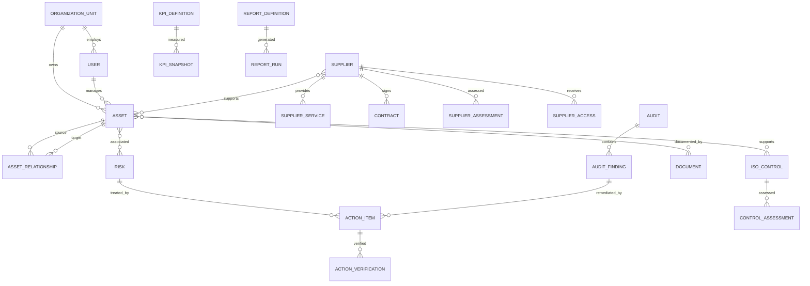

# PGCC — Modèle de données cible

**Statut :** Modèle logique de référence, à implémenter progressivement  
**Version :** 1.0  
**Date :** 21 novembre 2026

Ce document définit les principaux objets métier et leurs relations. Il ne constitue pas une migration SQL. Le schéma physique doit être adapté aux modèles existants et validé avant chaque migration.

## 1. Principes

- Identifiants techniques stables (UUID recommandé pour les nouveaux domaines, cohérence avec l'existant prioritaire).
- Références métier uniques lorsque nécessaires.
- Dates UTC en stockage ; affichage dans le fuseau utilisateur.
- Historique pour les objets à cycle de vie.
- Suppression logique pour les données métier qui doivent rester auditables.
- Relations explicites, contraintes et index.
- Éviter les colonnes JSON pour les relations qui doivent être interrogées, filtrées ou contrôlées par FK.

## 2. Domaines et entités

### Organisation
**OrganizationUnit**
- id, code, name, type, parent_id, manager_id, active
- hiérarchie des directions, départements et unités.

**User**
- Entité existante : identité, statut, rôle(s), permissions et périmètre.
- Les responsabilités métier peuvent référencer un utilisateur ou une unité organisationnelle.

### GRC existant
**Risk**
- id, reference, title, description, category, likelihood, impact, inherent_score, residual_score, status, owner, treatment, due_date.
- Relations à ajouter progressivement : actifs, fournisseurs, contrôles, actions et audits.

**ISOControl**
- id, reference, title, description, framework, category.

**ControlAssessment**
- id, control_id, assessment_period, status, maturity, assessor_id, assessed_at, comments.
- Une évaluation représente une appréciation à un instant/période, distincte de la définition du contrôle.

**Evidence / Document**
- id, metadata, classification, owner, version, status, valid_from, valid_until, storage_key.
- Références contrôlées aux objets métier.

**ActionItem**
- id, reference, title, description, origin_type, origin_id, priority, status, owner_id, due_date, completed_at.
- Relations existantes aux risques/contrôles à préserver.
- Historique de workflow et vérifications d'efficacité séparés.

**ActionVerification**
- id, action_id, verifier_id, outcome, observations, verified_at, evidence_id.
- Une action peut avoir plusieurs vérifications.

**Audit / AuditFinding**
- Audit : mission, périmètre, dates, équipe, statut.
- Finding : audit_id, référence, description, severity, recommendation, status.
- Les constats peuvent être associés aux risques, contrôles, actifs, fournisseurs et actions.

### Cartographie des actifs

**Application (entité existante)**
- Le module Applications existant demeure le référentiel applicatif fonctionnel ; il n'est pas remplacé par Asset.
- Les champs existants (nom, module, propriétaire, direction, hébergement, criticité, risque principal et plan de traitement) sont conservés.
- Une fiche Asset peut référencer une Application existante via application_id (relation 1:N côté Application : une application peut être reliée à plusieurs actifs techniques ; chaque actif référence au plus une application). Cela enrichit l'inventaire technique sans remplacer ni dupliquer le catalogue applicatif.
- Le lien application_id est facultatif pour les actifs non applicatifs. La migration 0008_asset_application_cardinality documente la suppression de l'ancienne cardinalité 1:1 ; le schéma physique et les contraintes de la migration restent la référence.

**Asset — cible logique et écart avec le modèle physique actuel**
- Identité : id, reference, name, description, asset_type.
- Responsabilités : à terme owner_user_id et/ou owner_unit_id, custodian_user_id ; le modèle physique actuel utilise encore les champs texte owner, custodian et direction.
- Localisation et cycle de vie : location, lifecycle_status, criticality, retired_at.
- CIA et classification : confidentiality, integrity, availability, classification.
- Attributs techniques : manufacturer, model, serial_number, hostname, ip_address, fqdn, operating_system, version, selon type.
- Inventaire : discovery_source, source_reference, last_inventory_date, end_of_support_date.
- Traçabilité physique actuelle : created_at, updated_at, retired_at ; les champs created_by/updated_by, business_value, purchase_date et deleted_at restent des éléments de cible non démontrés dans le modèle Asset actuel.

Les champs techniques sont optionnels et conditionnels au type d'actif. Une application ou un processus n'a pas besoin de numéro de série ; un équipement peut en avoir. Toute évolution des responsabilités vers des clés étrangères doit être additive, précédée d'un inventaire des utilisateurs/unités et d'une stratégie de reprise des valeurs texte.

**AssetRelationship**
- Modèle physique actuel : id, source_asset_id, target_asset_id, relationship_type, description, criticality, created_at, created_by.
- Types : depends_on, hosts, connects_to, stores, processes, supports, contains, communicates_with, supplied_by, other.
- Contraintes physiques actuelles : source et cible distinctes, unicité source/cible/type, clés étrangères restrictives.
- Champs de cible éventuels : direction explicite, valid_from, valid_until ; ils ne doivent pas être considérés comme implémentés sans migration et tests associés.
- Les relations peuvent être orientées ; l'interface peut afficher les deux directions.

**AssetRiskLink**
- asset_id, risk_id, relationship_context, created_at.
- Si une FK directe n'est pas adaptée à l'existant, utiliser une association dédiée plutôt qu'un polymorphisme libre.

**AssetControlLink**
- asset_id, control_id, relevance, notes.

**AssetDocumentLink**
- asset_id, document_id, relationship_type.

**AssetSupplierLink**
- asset_id, supplier_id, service_description, contract_id optional.

### Fournisseurs et tiers

**Supplier**
- id, reference, legal_name, trade_name, category, country, contact_details, status, owner_unit_id, risk_level, criticality, data_access_level.
- Dates de relation, revue, statut et source de données.

**SupplierService**
- id, supplier_id, name, description, service_scope, criticality, business_owner_id.
- Liens vers actifs, processus et risques.

**Contract**
- id, supplier_id, reference, title, start_date, end_date, renewal_date, status, owner_id, security_clauses_status, confidentiality_status, data_processing_status, exit_clause_status, document_id.
- Les contrats sont versionnés ou conservés comme documents avec métadonnées.

**SupplierAssessment**
- id, supplier_id, assessment_type, period, status, score, risk_level, assessor_id, assessed_at, next_review_date.
- Les réponses détaillées peuvent être modélisées par AssessmentQuestion/AssessmentAnswer.

**SupplierAccess**
- id, supplier_id, user_or_identity, access_scope, target_asset_id, approved_by, granted_at, expires_at, reviewed_at, status, revocation_date.
- Toute attribution et révocation d'accès doit être journalisée.

**SupplierRiskLink**
- supplier_id, risk_id, context.

### Pilotage

**KpiDefinition**
- id, code, name, description, calculation_method, source_domain, frequency, target, unit, owner, version, active.
- La formule et les filtres doivent être explicites et testables.

**KpiSnapshot**
- id, kpi_id, period_start, period_end, value, dimensions, calculated_at, source_version.
- Snapshot facultatif : les KPI peuvent aussi être calculés à la demande.

**ReportDefinition**
- id, code, title, report_type, audience, template_version, filters, active.

**ReportRun**
- id, report_definition_id, period, requested_by, status, generated_at, document_id, data_snapshot_reference.

### Transversal

**SecurityLog**
- Entité existante : acteur, action, cible, résultat, contexte, horodatage.
- Les logs ne doivent pas contenir de secrets ni de données sensibles inutiles.

**Notification**
- id, recipient, type, entity_reference, message, created_at, read_at, delivery_status.

## 3. Relations principales

## 4. Références polymorphes

Certaines fonctionnalités existantes peuvent utiliser des liens polymorphes (type + ID). Ils doivent :
- être limités à une liste de types autorisés ;
- être validés côté serveur ;
- être indexés ;
- être documentés ;
- ne pas remplacer une FK lorsque la relation est stable et centrale.

Pour les liens Asset/Risk/Control/Supplier/Action, préférer les tables d'association explicites quand elles portent des attributs métier ou doivent garantir l'intégrité référentielle.

## 5. Index et contraintes à prévoir

- Références métier uniques (Asset.reference, Supplier.reference, etc.).
- Index sur status, owner, criticality, due_date, lifecycle_status.
- Index des deux côtés d'AssetRelationship.
- Contraintes de cohérence dates (end_date >= start_date).
- Contraintes de validité d'accès fournisseur (expiration et révocation).
- Unicité des relations selon source, cible et type si applicable.
- Contrôle de valeurs enum et transitions de workflow côté service.

## 6. Cycle de vie des actifs

1. Identification / découverte.
2. Enregistrement et attribution de référence.
3. Classification et désignation propriétaire.
4. Validation de criticité et dépendances.
5. Revue périodique et mise à jour.
6. Changement / transfert.
7. Retrait / décommissionnement.
8. Archivage avec traçabilité.

Un actif décommissionné ne doit pas être supprimé si des risques, audits, actions ou preuves historiques le référencent.

## 7. Compatibilité avec l'existant

Avant toute migration :
1. Inspecter les modèles Application, Risk, Document, ActionItem et EntityLink.
2. Identifier les données et liens déjà présents.
3. Réutiliser les entités existantes si leur rôle correspond.
4. Définir les migrations non destructives.
5. Ajouter des tests de migration et d'intégrité.
6. Ne pas renommer ou supprimer les colonnes existantes sans plan de migration explicite.

## 8. Découpage d'implémentation

### Asset inventory MVP
- Asset, AssetRelationship.
- Références uniques, CRUD, filtres et pagination.
- Permissions, audit, validations.
- Association optionnelle à Application existante, Risk et Document.
- Tests modèles, API, sécurité et migration.

### Étape suivante
- Inventaire d'applications enrichi et dépendances.
- Liens fournisseurs.
- Analyse d'impact.
- Import CSV avec validation et rapport d'erreurs.
